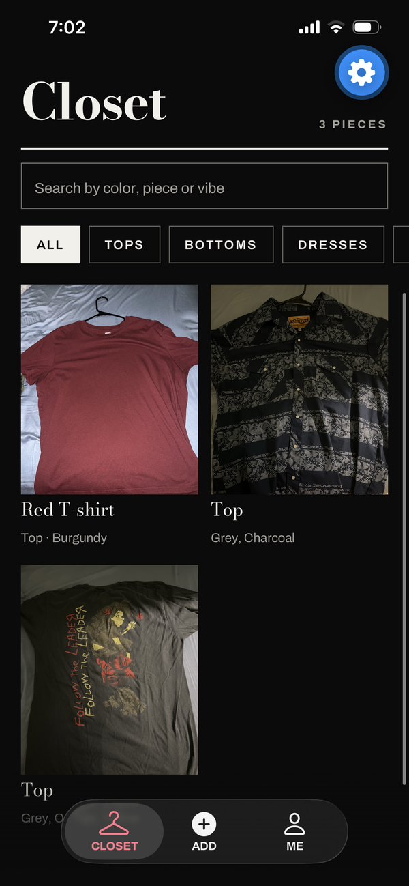
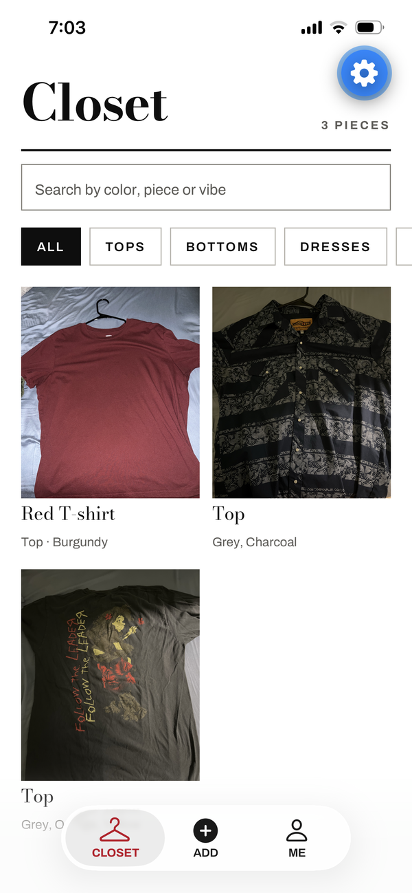
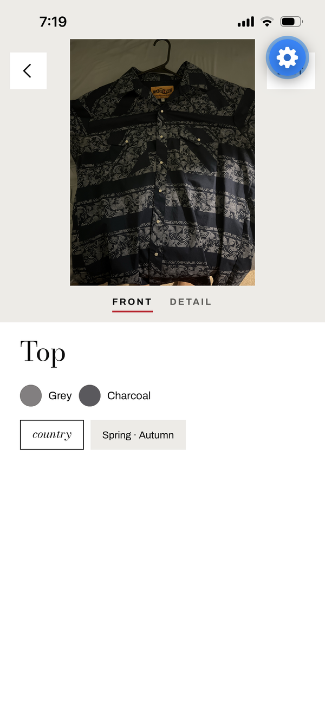
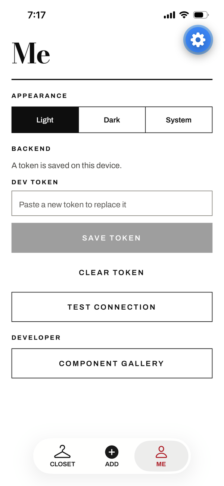
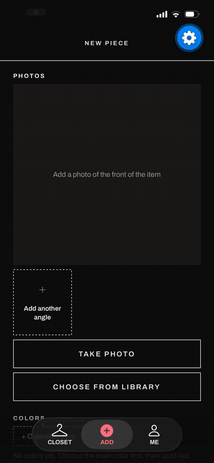
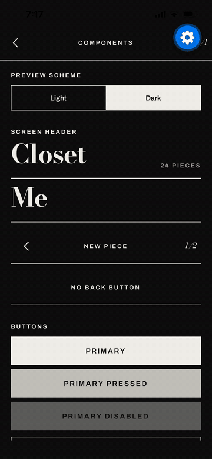

# Project Spotlight

> A clothing catalog app that scans your wardrobe and builds outfits from prompts like *"For summer"* or *"Emo vibes"*, built as a hands-on project in **agent-driven development**.

<p align="center">
  
  
  
  
</p>

<table>
  <tr>
    <td align="center"><b>Adding a piece to the closet</b></td>
    <td align="center"><b>Component gallery (design system)</b></td>
  </tr>
  <tr>
    <td align="center"></td>
    <td align="center"></td>
  </tr>
</table>

---

## Why this project exists

I've had this app idea for a while, so I used it as the vehicle for learning how AI agents work: how to structure them, how to prompt them, and how to keep them under control. The goal is a **working demo**, not a shipped product. What I'm really showing is the process: how I learned to direct agents to build real software, what went wrong along the way, and what I changed because of it.

## What the app does

- **Scan & catalog:** photograph clothing items to build a digital "closet"
- **Prompt-based outfits:** describe a vibe or occasion and an AI model suggests outfits from what you own
- **Accounts:** user accounts and a hosted database so your closet is saved
- **Editorial UI:** fashion-magazine visual style, with a "SPOTLIGHT" loading screen where the **O** becomes the beam of a spotlight

## Tech stack

| Layer | Choice |
|---|---|
| App | React Native with **Expo** |
| Backend | Hosted service Supabase|
| AI / outfit generation | Claude.ai |
| Development | Built almost entirely with AI agents (Claude Code), with human review gates |

## Status

🚧 **In progress: proof of concept.**

- [x] App design outline and flow (built as an artifact, then edited to my preferences)
- [x] Architecture and guidelines file
- [x] Adding a clothing item (first review gate)
- [ ] Outfit generation from prompts
- [ ] Accounts and sync

---

## How I built it: my agent workflow

```
  Plan & design ──► Guidelines file (CLAUDE.md) ──► Agent builds toward one milestone
        ▲                                                     │
        │                                                     ▼
  Timeline doc ◄── Agent reports changes & suggestions ◄── Human review gate
  (carries context                                       (I verify before
   across sessions)                                       the next milestone)
```

1. **Gated feedback loop.** At first I didn't know how to start a loop correctly. I solved it with a *gated* feedback loop: the agent works toward one specific, measurable goal (for example "a clothing item can be added to the app") and then stops at a checkpoint so I can verify it before moving on.
2. **A single guidelines file.** A main file of guidelines and constraints, updated with each decision as I make it, keeps the context in scope and keeps the agent consistent with earlier choices across sessions.
3. **Scoped prompts.** I had to learn what kind of prompts produce the right architecture without work leaking into other agents' areas or an agent running without control.
4. **Make the agent narrate.** Telling the agent to report its changes and ideas, rather than silently doing the work, made it much easier to understand where the codebase stands and what it recommends fixing.
5. **Review "lenses."** I ask the model to check my work from a specific point of view, e.g. *"As a senior developer, is there anything I'm missing architecturally that I failed to consider?"* This surfaces situations I might not have planned for.
   - Still testing whether the persona ("senior developer") matters or whether the question alone gets the same result.
6. **Design before code.** I had an artifact generated to outline how the app should look and flow, then edited it to match my preferences before any building started.
7. **A timeline doc for context management.** To use tokens better, I keep a running timeline doc. That lets me clear the context window and start fresh without losing the project's history.
8. **Different AI for different jobs.** I offload research to other AI tools, such as comparing backends for this project or weighing the pros and cons of each library before adopting it.

### Guidelines file excerpt

```
# Architecture rules
Screens stay thin. Logic lives in plain TypeScript modules under src/ (for example src/core for types and rules, src/data for repositories, src/ai for clients).
Anything backed by a service sits behind an interface: ClosetRepository, ClosetTagger, GarmentIsolator, OutfitGenerator. Each has a mock and a real implementation. Tests use the mocks.
Every closet item keeps its original photo and, separately, an optional cutout (the garment with the background removed, as a PNG with transparency). Never overwrite the original. Wherever a cutout is missing, the UI falls back to the original. Background removal is a step in the add-item flow behind GarmentIsolator. Its mock returns no cutout, and a failure there must never block saving the item.
Prompts, closet prefiltering, and outfit validation live in edge functions, not in the app. The app renders results and caches data.
Document the API in docs/api/ and update it in the same change as the endpoint. Request and response types live in one place. If sharing them between the app and the functions is awkward, keep copies and add a test that fails when they drift.
Outfit output is JSON referencing closet item IDs. Reject any ID that is not in the user's closet.
Avoid platform-specific APIs without a fallback. List any platform-specific code in the gate report.
```

---

## What I'm still working on

- **Workflow.** Since I'm learning as I go, I've lagged behind where I want to be. Spending more time on design and building my mental map up front comes first.
- **Architecture knowledge.** Using AI to fill gaps in architecture and learn things I had no idea about has worked well, but I have room to grow in how I approach design.
- **Token efficiency.** I don't think I'm wasting tokens, but I want to be more deliberate about using them well and make my prompts more efficient. The timeline doc (above) was my first step.
- **Multi-model agents.** Next I want to experiment with agents running on different models. For a proof of concept, this is where I'm at today.

## Key takeaways

- Agents need **boundaries and checkpoints**, not just instructions.
- **Persistent written context** (a guidelines file and a timeline) beats relying on chat history.
- Asking the agent to **explain itself** is as valuable as the code it writes.
- The quality of the output tracks the **quality of the plan** I bring to it.

---

## Running locally

```bash
git clone https://github.com/<your-username>/project-spotlight.git
cd project-spotlight
npm install
npx expo start
```

You'll need a `.env` with your backend keys. See `.env.example`.
